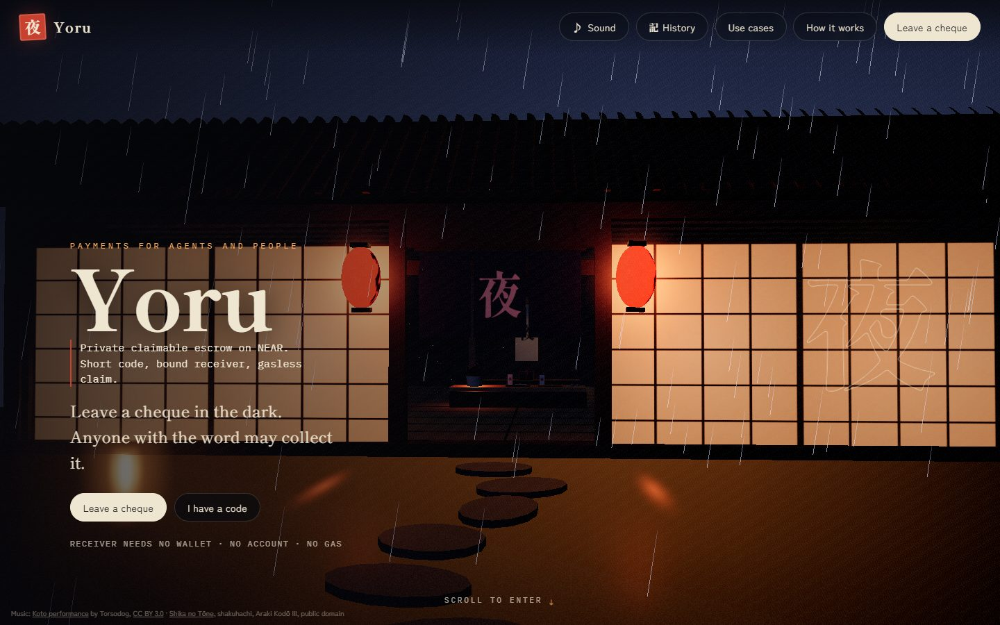
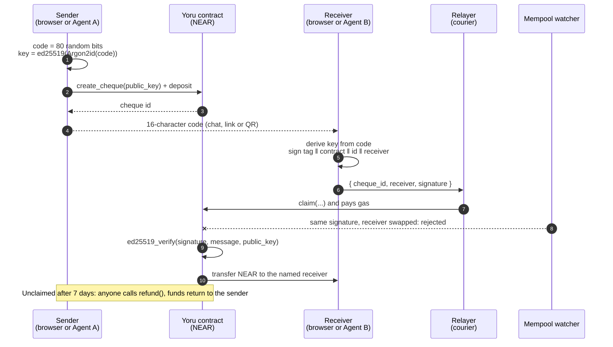
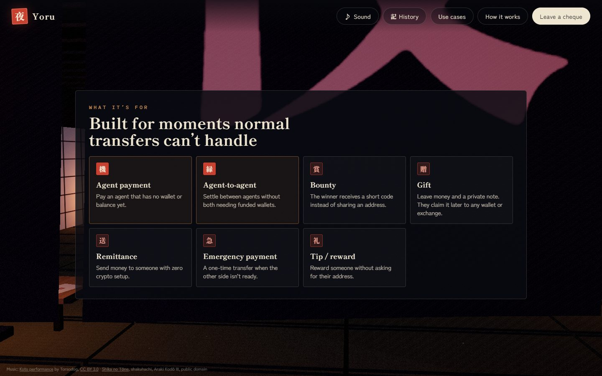
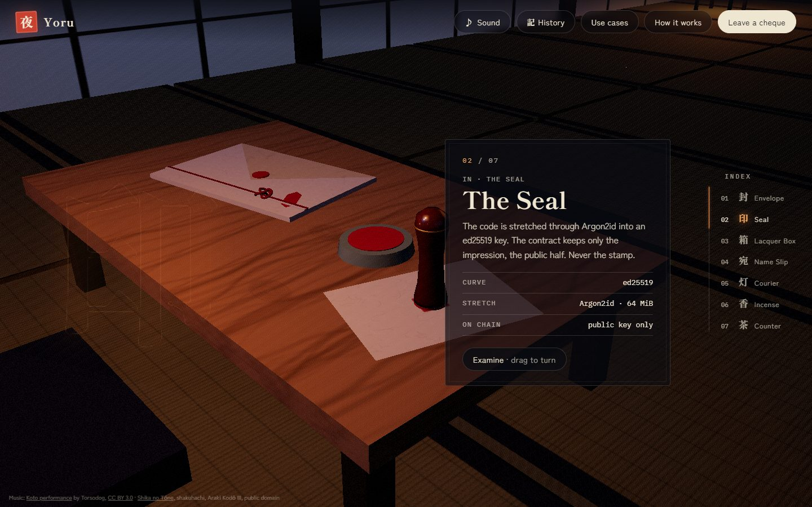
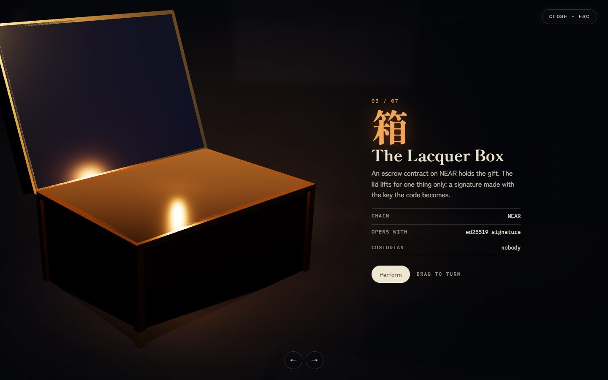
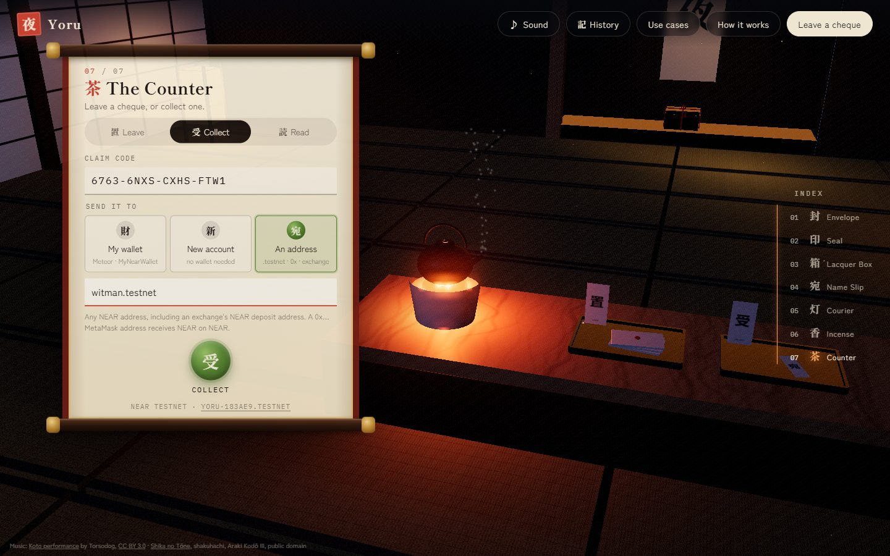
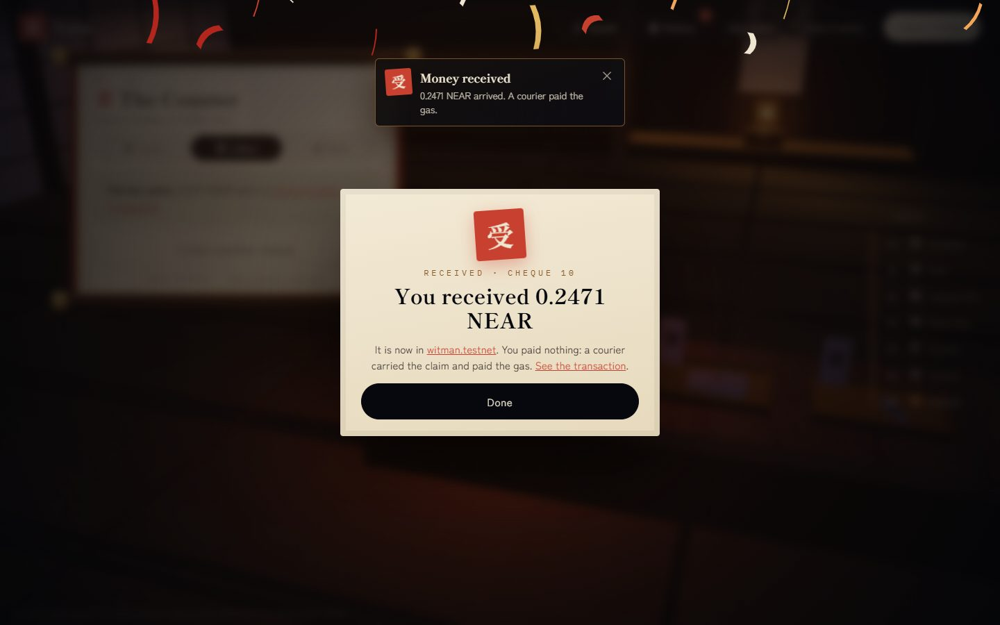
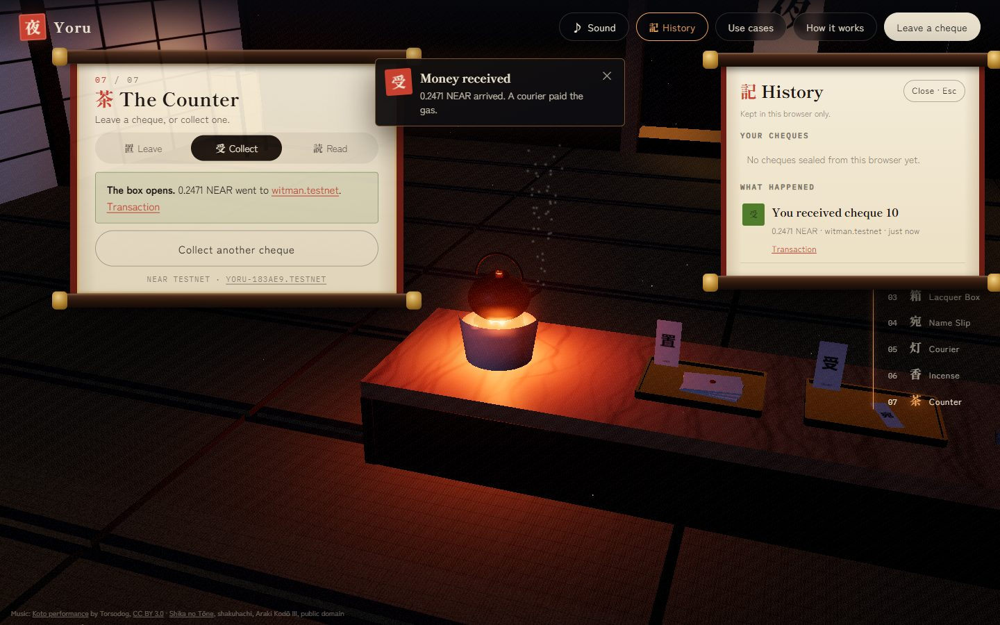
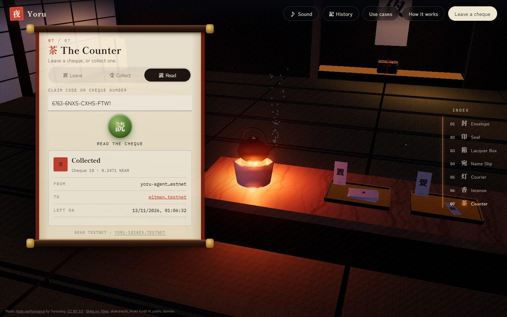
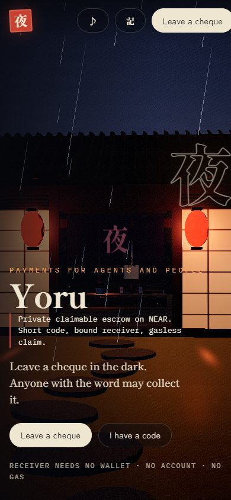

# 夜 Yoru

**Private claimable escrow on NEAR.** 
**Short code · bound receiver · gasless claim.**

### [▶ Try it live: yoru-cheque.up.railway.app](https://yoru-cheque.up.railway.app)

[Watch the demo on X](https://x.com/witman011/status/2121245409053921430) · built at the NEAR HACKATHON

Yoru is an agent-economy primitive on NEAR. Leave NEAR behind a
16-character claim code, with an optional private note sent alongside.
Anyone holding the code can claim to any address, **without a wallet, an
account or gas**. An AI agent can pay another agent that was created a
second ago, and any agent can act as the courier that pays the gas. It all
lives inside an interactive 3D Japanese tea house on a rainy night.

## Contents

| | |
|---|---|
| [Traditional payments, onchain](#traditional-payments-onchain) | [What the contract does](#what-the-contract-does) |
| [Why agents need this](#why-agents-need-this) | [Security](#security) |
| [Use cases](#use-cases) | [Agent demo](#agent-demo) |
| [How it works](#how-it-works) | [The experience](#the-experience) |
| [Architecture](#architecture) | [Run it](#run-it) |

---

## Traditional payments, onchain

For generations, people have paid each other with things the receiver claims
later: cheques, money orders, red envelopes. You never needed the other
person's bank details to write one. Yoru brings that idea to NEAR: the
sender deposits into escrow and gets a claim code; the receiver uses the code
and chooses where the money goes.

| | A paper cheque | Yoru |
|---|---|---|
| **What you hand over** | A signed slip of paper | A 16-character code, a claim link or a QR code |
| **Who can cash it** | The named payee, checked by a bank | Whoever holds the code; the receiving account is fixed when they sign |
| **Receiver needs** | A bank account | Nothing: a new account is created by the payment |
| **Where the money waits** | The sender's bank | An escrow contract nobody controls |
| **If it's never cashed** | It goes stale | After 7 days it returns to the sender |
| **Who it's for** | People | People and autonomous AI agents |

> **Traditional payment concept. Onchain execution. Agent-ready infrastructure.**

## Why agents need this

Agents can earn, but they can't get paid unless they already have a funded
wallet: an account to receive into, tokens for gas, and an address someone
has to ask for.

| Problem today | With Yoru |
|---|---|
| The receiver needs an account first | A brand-new implicit account is created by the payment |
| The receiver needs tokens for gas | The receiver never sends a transaction; a courier pays |
| The payer must learn an address in advance | The payer sends a code; the receiver picks the account at claim time |
| Claims can be front-run in the mempool | The receiver is inside the signature; a copied claim pays the same account |
| The payer must stay online | The payer funds the cheque and is done |
| Unclaimed payments can get stuck | After 7 days anyone can send it home to the payer |

## Use cases

| | Use case | In one line |
|---|---|---|
| 機 | **Agent payment** | Pay an agent that has no wallet or balance yet |
| 縁 | **Agent-to-agent** | Settle between agents without both needing funded wallets |
| 賞 | **Bounty** | The winner receives a short code instead of sharing an address |
| 贈 | **Gift** | Leave money and a private note; they claim it later to any wallet or exchange |
| 送 | **Remittance** | Send money to someone with zero crypto setup |
| 急 | **Emergency payment** | A one-time transfer when the other side isn't ready |
| 礼 | **Tip / reward** | Reward someone without asking for their address |

## How it works

| Step | | What happens |
|---|---|---|
| 1 | 封 **Seal** | The sender's browser (or agent) generates a random 16-character code (80 bits) and stretches it with **Argon2id** into an **ed25519** key pair |
| 2 | 箱 **Deposit** | `create_cheque(public_key)` locks the NEAR. The contract keeps only the public key; the code never touches the chain |
| 3 | 宛 **Sign** | The code holder derives the same key and signs `"yoru:claim:v1" ‖ contract_id ‖ cheque_id ‖ receiver` |
| 4 | 灯 **Deliver** | Anyone (a relayer) calls `claim(cheque_id, receiver, signature)` and pays the gas. The contract checks it with `env::ed25519_verify` and pays the receiver |
| 5 | 香 **Return** | Unclaimed after 7 days, anyone can call `refund(cheque_id)`, which pays only the original sender |

## Architecture

| Component | Built with | Role |
|---|---|---|
| `contract/` | Rust, near-sdk 5.30, cargo-near | Escrow, signature check, refunds, callbacks |
| `web/` | three.js 0.180, NEAR Wallet Selector 10, hash-wasm, @noble/ed25519 | The tea house, the counter, key derivation and signing in the browser |
| `agents/relayer.mjs` | Node, near-api-js 7 | Courier: accepts signed claims over HTTP, submits them, pays gas |
| `agents/*.mjs` | Node, near-api-js 7 | Agent A, Agent B, an attacker and a refunder for the demo |

## What the contract does

Deployed at [`yoru-183ae9.testnet`](https://testnet.nearblocks.io/address/yoru-183ae9.testnet).

| Method | Kind | Who can call | Deposit | What it does |
|---|---|---|---|---|
| `create_cheque(public_key)` | Payable | Anyone (the sender) | Amount + storage | Stores a cheque under the code's public key and returns its id. Storage is taken from the deposit |
| `claim(cheque_id, receiver, signature)` | Change | Anyone (usually a relayer) | None | Verifies the ed25519 signature over the claim message, then transfers the amount to `receiver` |
| `refund(cheque_id)` | Change | Anyone, after 7 days | None | Returns an unclaimed cheque to its sender; pays only the sender |
| `get_cheque(cheque_id)` | View | Anyone | None | Amount, status, sender, receiver, created and expiry times |
| `get_cheque_by_key(public_key)` | View | Anyone | None | Finds a cheque from the key a code derives, so a receiver needs only the code |
| `on_claim_transfer` · `on_refund_transfer` | Private callback | The contract | None | Marks a cheque collected or returned, or reopens it if the transfer failed |

**A cheque's life**

| Status | Meaning | Next |
|---|---|---|
| `Open` | Waiting in the box | `Claiming` with a valid signature, or `Refunding` after 7 days |
| `Claiming` | Transfer to the receiver in flight | `Claimed`, or back to `Open` if the transfer failed |
| `Claimed` | Delivered | Final |
| `Refunding` | Going back to the sender | `Refunded`, or back to `Open` if the transfer failed |
| `Refunded` | Returned to the sender | Final |

**Unit tests** (`cargo test`, all passing)

| Test | Checks |
|---|---|
| `create_keeps_storage_out_of_the_amount` | Storage is paid from the deposit, not the receiver's amount |
| `rejects_a_reused_key` · `rejects_a_deposit_that_only_covers_storage` | Bad deposits are refused |
| `relayer_submits_and_the_named_receiver_is_paid` | A third party submits; the named receiver is paid |
| `a_copied_signature_cannot_pay_someone_else` | Swapping the receiver breaks the signature |
| `a_signature_from_the_wrong_code_fails` | Only the code's key can claim |
| `a_replay_after_the_claim_fails` | A cheque pays out once |
| `a_failed_transfer_reopens_the_cheque` | The code still works after a failed transfer |
| `a_claim_after_seven_days_fails` · `a_refund_before_seven_days_fails` | The window is enforced both ways |
| `a_refund_after_seven_days_returns_to_the_sender` · `a_refunded_cheque_cannot_be_claimed` | Refunds pay the sender and close the cheque |

## Security

| Threat | What stops it |
|---|---|
| A claim copied from the mempool is redirected | The receiver is inside the signed bytes; changing it fails verification |
| A claim is front-run unchanged | It still pays the original receiver; the front-runner only pays gas |
| A claim is replayed | One payout per cheque: `cheque is not open` |
| A signature is reused on another deployment | The contract id is part of the signed message |
| Codes are guessed offline | 80 random bits plus memory-hard Argon2id (64 MiB) |
| The relayer learns the code | It only ever sees the cheque id, the receiver and a signature |
| Funds get stuck | Failed transfers reopen the cheque; after 7 days anyone can refund to the sender |

> **Private-ish, honestly.** The code never touches the chain or the relayer,
> and receivers don't publish an address in advance. The chain still shows
> which account funded a cheque and which account it paid.

Not audited and testnet only. See [SECURITY.md](SECURITY.md) to report a
vulnerability.

## Agent demo

Five Node scripts act out an agent-to-agent payment on testnet. Every row
below happened on chain.

| Script | Role | Result on testnet |
|---|---|---|
| `agent-a.mjs pay 0.5` | Payer funds a cheque, sends only the code | [create_cheque](https://testnet.nearblocks.io/txns/5TiTm5PhyzFbtWmGptmnVqqJv83CrRxwmNiATVLpqzz1) |
| `agent-b.mjs claim` | Receiver with no account signs a claim | Account "does not exist", then holds 0.497 NEAR |
| `relayer.mjs` | Courier submits and pays gas | [claim](https://testnet.nearblocks.io/txns/EpdfGYEBVbpyKvTeDXjaBKiZKXhzddyBWNq3Cnw9PQAR) |
| `attacker.mjs --intercept` | Swaps the receiver | [Rejected](https://testnet.nearblocks.io/txns/GWQhxfWYqxNUpYP8PLhoXBGfA8V6SR4Ph3PhUqVDmLJb): signature does not match |
| `attacker.mjs --intercept` | Front-runs unchanged | [Accepted, paid Agent B](https://testnet.nearblocks.io/txns/7eDrxJEssxJ8qi5FtkQ7LF8URoqLNNXcqU7C3vPpqsKw); the attacker paid B's gas |
| `refund.mjs <id> --demo` | A stranger sends an expired cheque home | [Returned to Agent A](https://testnet.nearblocks.io/txns/1Sq3GWjAwmEPhpRwhLHpmKeaNQxvLc3vKBQ1wqKKMQx) |

The full judge script is in [docs/submission.md](docs/submission.md).

## The experience

A Japanese tea house on a rainy night, built entirely in three.js code: **no
3D models and no texture files**. Scrolling walks you through seven objects,
one per step of the protocol, to the counter where you use it.

| | |
|---|---|
|  |  |
| **The Seal.** Each object explains one step. | **Close-ups.** Click an object to turn it and watch it work. |
|  |  |
| **The counter.** A hanging scroll: Leave, Collect or Read. | **A real claim.** 0.2471 NEAR to `witman.testnet`; the courier paid the gas. |
|  |  |
| **History.** Live status, and a toast when your cheque is collected. | **Read.** Look any cheque up without touching it. |

| Feature | Details |
|---|---|
| 置 **Leave** | Wallet (Meteor or MyNearWallet), amount, an optional note that never goes on chain. The code is shown once with a **claim link** and a **QR code** |
| 受 **Collect** | To **my wallet**, a **new account** (download its key) or **any address**: `name.testnet`, 64-character, exchange deposit or `0x…` MetaMask |
| 読 **Read** | Look up any cheque by code or number; send an expired one home |
| 記 **History** | Your cheques with live status, plus a toast when one is collected |
| **Moments** | Toasts, falling paper ribbons, and "sealed" and "received" cards |
| **Sound** | Real instruments: a koto performance and a shakuhachi honkyoku recording |
| **Docs** | [`web/docs.html`](web/docs.html), the same guide inside the site |

## Live on NEAR testnet

| | |
|---|---|
| **Website** | [yoru-cheque.up.railway.app](https://yoru-cheque.up.railway.app) |
| **Docs** | [yoru-cheque.up.railway.app/docs.html](https://yoru-cheque.up.railway.app/docs.html) |
| **Courier (relayer)** | `POST https://yoru-cheque.up.railway.app/claim`, hosted on Railway, pays the gas |

| Contract | Claim window | Used for |
|---|---|---|
| [`yoru-183ae9.testnet`](https://testnet.nearblocks.io/address/yoru-183ae9.testnet) | 7 days | The site and the agents |
| [`yoru-demo-183ae9.testnet`](https://testnet.nearblocks.io/address/yoru-demo-183ae9.testnet) | 3 minutes | Showing the refund live |

## Run it

| What | Command |
|---|---|
| Install | `npm install` |
| Website + courier together | `npm start`, then open http://localhost:8787 |
| Relayer alone (for the agents) | `node agents/relayer.mjs` |
| Agent A pays | `node agents/agent-a.mjs pay 0.5` |
| Agent B collects | `node agents/agent-b.mjs claim` |
| Attack demo | `node agents/agent-b.mjs claim --hold` then `node agents/attacker.mjs --intercept` |
| Contract tests | `cd contract && cargo test` |
| Contract build | `cargo near build non-reproducible-wasm --no-abi` (add `--features demo-window` for 3 minutes) |

On Windows with the GNU Rust toolchain, `cargo test` needs MinGW-w64
installed at a path without spaces.

**Deploying:** `server.mjs` serves `web/` and the courier on one port, so any
Node host works. Set `RELAYER_PRIVATE_KEY` to the relayer account's key
(`ed25519:…`) and, optionally, `RELAYER_DAILY_CAP`. The live site runs on
Railway with Node 24.

## Repository

| Path | What |
|---|---|
| `contract/` | Rust escrow contract and its 12 unit tests |
| `server.mjs` | One process for the website and the courier (`npm start`) |
| `agents/` | Agent A, Agent B, the relayer, the attacker and the refunder |
| `web/` | The tea house (`index.html`) and the docs page (`docs.html`) |
| `web/audio/` | Koto (CC BY 3.0, Torsodog) and shakuhachi (public domain) recordings from Wikimedia Commons |
| `docs/` | Submission notes, the judge demo script, the project story and screenshots |
| `SECURITY.md` | Security model and how to report a vulnerability |

## Limits

| Limit | Note |
|---|---|
| Testnet only | Not audited; don't use with real funds yet |
| Exchanges | Need mainnet; some require a memo, which a plain transfer can't carry |
| MetaMask | A `0x…` address receives NEAR on NEAR, not ETH on Ethereum |
| Bearer codes | Whoever holds the code or link can collect; send it only to the intended person |
| Relayer | One hosted courier with per-IP and daily limits; anyone can run another, since the contract doesn't care who submits |

## Credits

Music: [Koto performance](https://commons.wikimedia.org/wiki/File:Koto_performance.ogg)
by Torsodog ([CC BY 3.0](https://creativecommons.org/licenses/by/3.0/)) ·
[Shika no Tōne](https://commons.wikimedia.org/wiki/File:Shikanotoone_new.ogg),
shakuhachi, Araki Kodō III (public domain).
